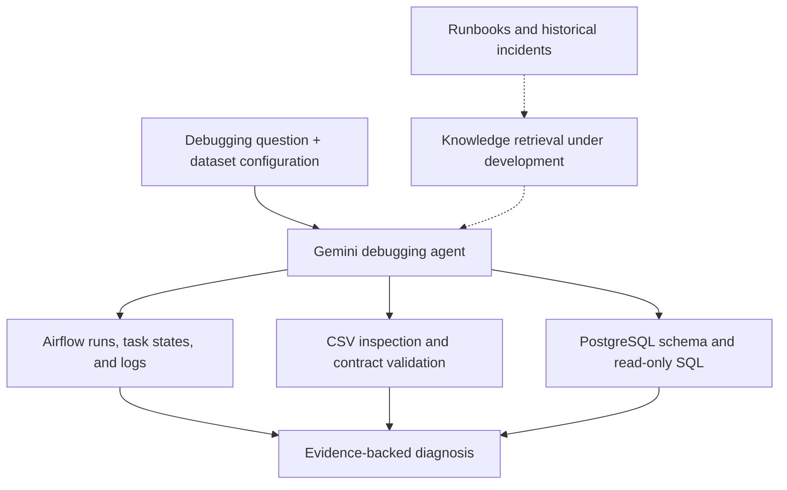

# Data Pipeline Debugging Agent

An ongoing project exploring how an LLM agent can diagnose failed data pipelines using execution logs, dataset contracts, and database evidence.

The prototype uses Gemini tool calling to investigate Airflow pipelines and produce a diagnosis with **Root Cause**, **Evidence**, and **Recommended Action**. Orders and payments pipelines provide controlled examples of schema drift, invalid values, duplicate records, and database failures.

## How It Works



The agent distinguishes failed tasks from downstream tasks marked `upstream_failed`, checks observed input against the configured contract, and uses database inspection where needed. Its SQL tool uses a read-only database session. It recommends actions rather than automatically repairing the pipeline.

## Current Progress

| Component | Status |
| --- | --- |
| Airflow and PostgreSQL demo environment | Implemented |
| Orders and payments demonstration DAGs | Implemented |
| Dataset configuration and contract validation | Implemented |
| Gemini automatic function-calling diagnosis | Implemented |
| Controlled incident evaluation harness | Implemented; small saved test runs available |
| Knowledge document chunking and embedding index | Implemented prototype |
| Semantic knowledge search | In active local development |
| Knowledge search integrated into the main diagnosis agent | Not yet wired into the current agent |

The main entry point is `agent/debug_agent_afc.py`. An earlier manual tool-calling loop remains in `agent/debug_agent.py`.

## Preliminary Evaluation

Saved local results cover small sets of controlled incidents:

| Dataset | Saved outcome | Interpretation |
| --- | --- | --- |
| Orders | 3 of 4 cases passed | One case was interrupted by a Gemini API quota error. |
| Payments | 4 of 4 cases passed | All four saved cases passed the configured keyword checks. |

The evaluator checks whether the diagnosis contains required keyword groups. These results are smoke-test evidence, not a general measure of root-cause accuracy or production reliability. The saved runs do not establish the benefit of knowledge retrieval.

## Repository Guide

| Path | Purpose |
| --- | --- |
| `agent/` | Agent loops, Airflow/database/data tools, contracts, and retrieval prototypes |
| `configs/` | Dataset-specific contracts and pipeline settings |
| `dags/` | Orders and payments demonstration pipelines |
| `data/` | Demo inputs, incident fixtures, and intermediate data |
| `evaluation/` | Incident cases, evaluation runner, and saved results |
| `knowledge/` | Runbooks, concepts, technical references, and historical incidents |
| `knowledge_index/` | Generated embeddings and chunk metadata |
| `docker-compose*.yaml` | Local Airflow and PostgreSQL services |
| `config/` | Local Airflow configuration |

## Running a Diagnosis

This is a development prototype rather than a one-command installation. It requires a running Docker Compose environment, registered demo DAGs, suitable database tables and input files, and authenticated access to Airflow and Gemini.

The host-side agent uses Python 3.10+ with `google-genai` and `psycopg2`; the retrieval tools also use NumPy. A pinned dependency manifest has not yet been added.

Set credentials in your shell or a local secrets manager:

```bash
export GEMINI_API_KEY="your_gemini_api_key"
export AIRFLOW_API_URL="http://localhost:8080"
export AIRFLOW_USERNAME="your_airflow_username"
export AIRFLOW_PASSWORD="your_airflow_password"
```

Alternatively, set `AIRFLOW_TOKEN` for Airflow authentication. Set `ORDERS_DB_HOST`, `ORDERS_DB_PORT`, `ORDERS_DB_NAME`, `ORDERS_DB_USER`, and `ORDERS_DB_PASSWORD` to match your database. These database environment-variable names are currently shared by the demo datasets.

`GEMINI_MODEL` can override the model configured in the agent; use a model available to your account. The Python agent does not automatically load `.env`, so export the variables in the shell that launches it.

From the repository root, with the demo services already configured:

```bash
python agent/debug_agent_afc.py orders
python agent/debug_agent_afc.py payments
python agent/debug_agent_afc.py orders --question "Why did the latest pipeline run fail?"
```

Use `--run-id` to investigate a specific Airflow run.

The evaluation runner is different from a diagnosis command: it replaces demo input files, triggers DAG runs, calls Gemini, and writes evaluation outputs. Run it only in a dedicated test environment. Embedding-index generation also makes API calls.

## Next Steps

- Integrate semantic knowledge search into the diagnosis toolset.
- Check whether retrieved runbooks improve diagnoses beyond runtime evidence alone.
- Expand incident coverage and use stronger evaluation than keyword matching.
- Improve setup reproducibility and separate deployment secrets from tracked configuration.

## Scope and Security

This project investigates diagnosis in a controlled local environment. It does not demonstrate production-ready remediation or reliable diagnosis across arbitrary pipelines.

Tool observations, including logs and data samples, may be sent to Gemini. Use synthetic or approved data and review what the tools expose before connecting real systems.

Keep API keys, Airflow signing secrets, database credentials, and private logs out of Git. The current deployment configuration still needs a security cleanup before public release; `.env` being ignored does not protect secrets copied into tracked files. Rotate any exposed credentials and remove sensitive values from both current files and Git history where necessary.
